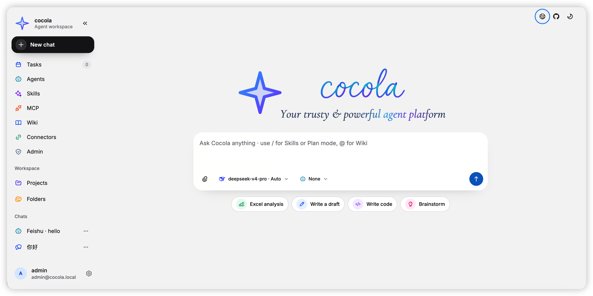
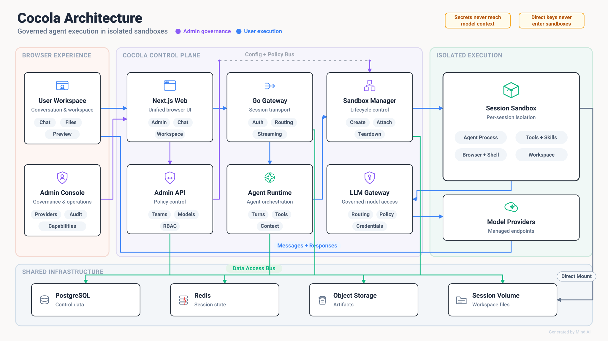

<p align="right">
  <strong>English</strong> · <a href="./README.zh-CN.md">简体中文</a>
</p>

<div align="center">
  <h1>
    
  </h1>
  <p><strong>Open-source, self-hosted AI Agent workspace for teams</strong></p>

  <p>
    <a href="#quick-start">Quick start</a> ·
    <a href="./docs">Documentation</a> ·
    <a href="./CONTRIBUTING.md">Contributing</a> ·
    <a href="https://github.com/sakurs2/cocola/releases">Releases</a>
  </p>

  <p>
    <a href="https://github.com/sakurs2/cocola/actions/workflows/ci.yml"></a>
    <a href="https://github.com/sakurs2/cocola/releases"></a>
    <a href="./LICENSE"></a>
    <a href="./SECURITY.md"></a>
    <a href="./CONTRIBUTING.md"></a>
  </p>

  <p>
    <a href="./docs/cli.md"></a>
    <a href="./docs/cli.md"></a>
    <a href="./docs/cli.md"></a>
    <a href="https://github.com/opensandbox-group/OpenSandbox"></a>
    <a href="./docs/cli.md"></a>
  </p>

  <p>
    <a href="./apps/web/package.json"></a>
    <a href="./go.work"></a>
    <a href="./apps/agent-runtime/pyproject.toml"></a>
    <a href="./package.json"></a>
  </p>
</div>

<p align="center">
  
</p>

Cocola is more than a model chat interface. Every conversation gets an isolated, persistent workspace where an Agent can read files, write code, run commands, browse the web, and stream its execution process directly in the browser. Administrators can centrally manage models, users, Skills, MCP servers, usage, and audit records.

## Core capabilities

| Agent workflows                                                                                                               | Platform infrastructure                                                                                                              |
| ----------------------------------------------------------------------------------------------------------------------------- | ------------------------------------------------------------------------------------------------------------------------------------ |
| 🧠 **Native Agent Runtime**<br>Uses Claude Code's native reasoning loop instead of reducing an Agent to custom tool groups.   | 🔒 **Session-isolated sandboxes**<br>Reasoning and native tools run in an independent OpenSandbox environment with persistent files. |
| 🧰 **Complete workspace**<br>Use Files, Code, Shell, Git, and Preview in the sidebar to follow execution and inspect outputs. | 🔀 **Unified model gateway**<br>Centrally manage model providers and routing compatible with Anthropic Messages.                     |
| 🧩 **Reusable capabilities**<br>Assemble team-specific Agents with custom Agents, Skills, MCP servers, and Knowledge.         | 🛡️ **Team governance**<br>Manage users, usage, scheduled tasks, run tracing, audit logs, and sandbox operations.                     |
| 🌿 **Project workflows**<br>Support local and GitHub Projects; GitHub Tasks use isolated branches and confirm risky writes.   | 🏠 **Fully self-hosted**<br>Keep the application, model credentials, conversations, and workspaces on your infrastructure.           |

## Quick start

Production deployments use the Cocola CLI. Requirements:

- Linux or macOS on `amd64` or `arm64`;
- Docker Engine 20.10.0 or newer, or Docker Desktop with an equivalent engine;
- Docker Compose 2.23.1 or newer.

Docker Engine 20.10.0 is the technical minimum required for `host-gateway`; Docker Compose 2.23.1 is the minimum required for inline `configs.content`. Cocola has also completed end-to-end validation of healthy service startup and dynamic Sandbox creation, execution, and teardown on Docker Engine 20.10.24 with Docker Compose 2.23.1.

**1. Install**

Download the latest release and complete the interactive setup:

```bash
curl -fsSL https://raw.githubusercontent.com/sakurs2/cocola/master/scripts/install.sh | sh
```

Except for the official Alibaba Cloud image used by OpenSandbox Execd, cold-start images are downloaded from `ghcr.io`. Cocola does not modify the Docker daemon configuration or silently switch to a public proxy when a download fails.

The installer downloads the CLI for the current platform, verifies its SHA-256 checksum, and writes the deployment configuration to `~/.cocola`. The web application listens on all network interfaces by default and is available at `http://<server-ip>:3000` without additional address configuration. Save the administrator password shown once by the installer.

**2. Start**

```bash
cocola start
```

Users in mainland China can explicitly use a compatible GHCR proxy on the first start. Cocola remembers the endpoint after a healthy startup:

```bash
cocola start --ghcr-endpoint ghcr.nju.edu.cn
```

Switch back to the official endpoint with `cocola start --ghcr-endpoint ghcr.io`. If the proxy fails, Cocola restores the previous deployment configuration without an implicit fallback or changes to a custom Cocola Registry.

On first start, Cocola checks Docker, Compose, ports, and disk space, pre-pulls pinned service and sandbox runtime images, and waits for services including Sandbox Manager, Agent Runtime, and Web to become healthy. After a clean stop, subsequent starts reuse local images without depending on registry availability.

**3. Configure a model**

Open [http://localhost:3000](http://localhost:3000) and sign in.

> [!IMPORTANT]
> After the first start, go to `Admin → Models` to configure a model provider and default model before starting your first conversation.

<details>
<summary><strong>Common operational commands</strong></summary>

<br>

```bash
cocola status
cocola logs -f
cocola doctor
cocola stop
```

</details>

See the [Cocola CLI documentation](./docs/cli.md) to install a specific version, use an external OpenSandbox deployment, or run a non-interactive installation. To upgrade, run the same installation command again. The CLI preserves existing accounts, ports, secrets, and custom configuration, creates an upgrade backup, and migrates the deployment files. Then run `cocola start` to apply the new version. If the upgrade fails, the CLI restores the previous configuration and provides commands to either recover the old version or retry the upgrade. `cocola doctor` performs read-only checks of service health, disk space, volumes, PostgreSQL credentials, and required images.

## Architecture

<p align="center">
  
</p>

Cocola separates the control plane from the execution plane:

1. Web and Gateway handle authentication, conversations, SSE/WebSocket streams, and the unified browser entry point.
2. Agent Runtime acts as the control-plane router, prepares the environment, and forwards each Run to the current conversation's Sandbox.
3. Claude Code and its native tools run inside the Sandbox; a Session Volume persists files.
4. LLM Gateway connects model providers and handles routing, credential protection, quotas, and usage metering.
5. Admin API manages users, models, Skills, MCP servers, schedules, audits, and platform configuration.

Core infrastructure includes PostgreSQL, Redis, S3-compatible object storage, and OpenSandbox. The official `v0.1.0` installation is a single-host Docker Compose deployment managed by the Cocola CLI. The Sandbox plane can use the bundled OpenSandbox deployment or connect to an external OpenSandbox service.

Primary technologies: Next.js, TypeScript, Go, Python, gRPC, PostgreSQL, Redis, and OpenSandbox.

## Local development

Local development runs application services as native processes with containerized infrastructure:

```bash
git clone https://github.com/sakurs2/cocola.git
cd cocola
cp .env.example .env
make dev
```

See [CONTRIBUTING.md](./CONTRIBUTING.md) for the complete toolchain, dependency setup, and commit checks.

## Documentation

The complete documentation site will launch with `v0.1.0`. Until then, start with these repository documents:

| Document                                                    | Contents                                              |
| ----------------------------------------------------------- | ----------------------------------------------------- |
| [CLI installation and operations](./docs/cli.md)            | Installation, deployment, diagnostics, and operations |
| [Configuration reference](./docs/configuration.md)          | Environment variables and deployment configuration    |
| [Projects and GitHub Connector](./docs/github-projects.md)  | Projects, tasks, and GitHub integration               |
| [Conversation reliability](./docs/core-chat-reliability.md) | Run lifecycle, reconnection, and error handling       |
| [Architecture decision records](./docs/adr/README.md)       | Important architectural choices and their context     |

<!-- Replace this section's links with the documentation site URL when GitHub Pages is available. -->

## Contributing

Issues and pull requests are welcome. Before starting a substantial feature or architectural change, discuss the scope in [GitHub Issues](https://github.com/sakurs2/cocola/issues) and read the [contribution guide](./CONTRIBUTING.md).

Report security issues privately by following [SECURITY.md](./SECURITY.md). Do not create a public issue.

## License

Cocola is open source under the [Apache License 2.0](./LICENSE).
